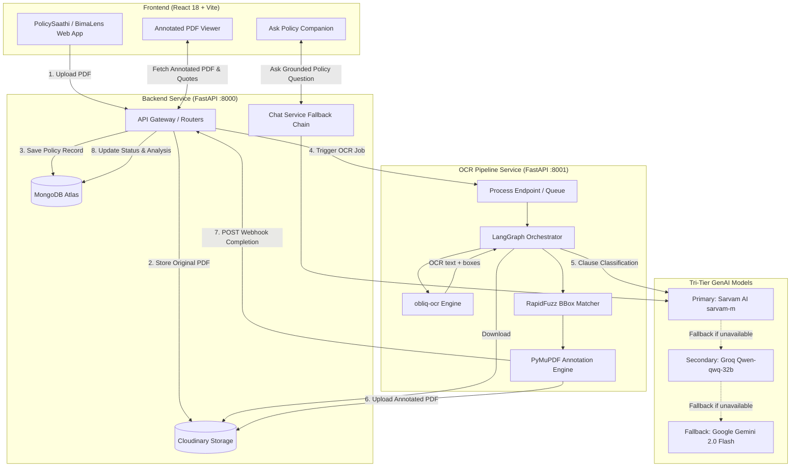

# BimaLens — Insurance, in Focus 🔍🛡️

> **Multimodal AI Insurance Policy Intelligence & Grounded Clause Attribution System**  
> *Transforming opaque, 50-page insurance documents into clear, cited, and actionable insights.*

[](https://fastapi.tiangolo.com)
[](https://react.dev/)
[](https://www.langchain.com/)
[](https://langchain-ai.github.io/langgraph/)
[](https://www.sarvam.ai/)
[](https://groq.com/)
[](https://www.mongodb.com/atlas)
[](https://cloudinary.com/)

---

## 🌟 Overview

Most policyholders in India never read or comprehend the fine print of their life, health, or annuity insurance policies until a critical claim arises. Buried deep inside 20 to 50-page documents are restrictive waiting periods, sub-limits, existence certificate mandates, strict death-claim filing windows (e.g., within 90 days), and free-look cancellation terms.

**BimaLens** bridges this gap using a **microservice-oriented AI architecture**:
1. **Layout-Aware Document Ingestion:** Parses digital and scanned policy documents with `obliq-ocr`.
2. **AI Clause Classification:** Extracts key clauses across 6 legal categories using LangChain with a tri-tier model fallback chain (**Sarvam AI** ➡️ **Groq Qwen** ➡️ **Google Gemini**).
3. **Sub-Pixel Coordinate Matching:** Fuzzy maps verbatim quotes back to original PDF bounding boxes using `rapidfuzz`.
4. **Color-Coded PDF Annotation Engine:** Generates an enriched, interactive PDF with highlighted clauses using `PyMuPDF`.
5. **Grounded Policy Companion:** Answers natural-language questions strictly grounded in the document wording, returning exact page and clause citations.

---

## 🏗️ System Architecture

The following diagram illustrates the flow from policy upload to OCR ingestion, clause extraction, PDF annotation, and real-time conversational retrieval:



---

## 🎨 Color-Coded Clause Taxonomy

Every extracted clause is classified and highlighted in the policy PDF according to an intuitive, standardized legal color scheme:

| Category | Color Code | RGB (PyMuPDF) | Description & Key Examples |
| :--- | :---: | :---: | :--- |
| **Coverage** | 🟢 Emerald Green | `(0.13, 0.77, 0.37)` | Sum insured, covered annuity benefits, death benefits, covered hospitalization events. |
| **Exclusion** | 🔴 Crimson Red | `(0.94, 0.27, 0.27)` | Non-payable items, suicide clauses, pre-existing disease waiting periods. |
| **Financial** | 🔵 Royal Blue | `(0.23, 0.51, 0.96)` | Premiums, deductibles, co-payment percentages, stamp duty deductions upon surrender. |
| **Obligation** | 🟠 Amber Orange | `(0.96, 0.62, 0.04)` | Claim filing deadlines (e.g., 90-day written notice), submission of Existence Certificates. |
| **Metadata** | 🟣 Violet Purple | `(0.55, 0.36, 0.96)` | Policy UIN, Plan name, insurer registration number, effective dates. |
| **Red_Flag** | 🛑 Magenta/Ruby | `(0.86, 0.15, 0.47)` | Critical restrictions, QROPS HMRC guidelines, forfeiture clauses, strict conditions. |

---

## 📁 Repository Structure

```
BimaLens/
├── assests/                                # Architecture diagrams, sample policies, research notebooks
│   ├── bimalens-system-architecture.png    # High-level architecture schematic
│   ├── paytm-ocr-pipeline.ipynb            # Foundation OCR & fuzzy-matching experiments
│   └── sample_policy.pdf                   # LIC New Jeevan Shanti benchmark policy
│
├── backend/                                # FastAPI Core Business Logic & Gateway (:8000)
│   ├── app/
│   │   ├── models/                         # Pydantic data schemas (PolicyDocument, AskRequest)
│   │   ├── routers/                        # /api/v1/policies, /api/v1/chat, /webhooks
│   │   ├── services/                       # policy_service, chat_service, ocr_client
│   │   ├── utils/                          # MongoDB serializers, ObjectId helpers
│   │   ├── cloudinary_client.py            # PDF upload integration
│   │   ├── config.py                       # App settings (Pydantic BaseSettings)
│   │   ├── database.py                     # Motor async MongoDB client
│   │   └── main.py                         # FastAPI application entrypoint
│   ├── Dockerfile                          # Container definition for Backend
│   ├── requirements.txt                    # Python dependencies
│   └── .env.example                        # Backend environment template
│
├── ocr-pipeline/                           # Standalone OCR & Annotation Microservice (:8001)
│   ├── app/
│   │   ├── models/                         # Schemas (ProcessRequest, PageClassification, MatchedQuote)
│   │   ├── pipeline/                       # LangGraph orchestrator, obliq-ocr wrapper, rapidfuzz matcher
│   │   ├── services/                       # Cloudinary uploader, backend callback client
│   │   ├── config.py                       # Pipeline configuration & rate-limit tuning
│   │   └── main.py                         # FastAPI async background worker endpoint
│   ├── Dockerfile                          # OCR Pipeline container
│   ├── requirements.txt                    # OCR, PyMuPDF, LangChain, LangGraph dependencies
│   └── .env.example                        # OCR Pipeline environment template
│
├── frontend/                               # React 18 + Vite SPA (:5173)
│   ├── src/
│   │   ├── api/client.js                   # Axios client for backend API
│   │   ├── store/useStore.js               # Zustand global state (policies, analysis, chat)
│   │   ├── components/                     # Brand, AppShell, UploadModal, PDFViewer, PoweredBy
│   │   ├── pages/                          # Landing, Overview, Policies, Reader, Ask, Fit, Claims
│   │   ├── App.jsx                         # Main React application & routing
│   │   ├── main.jsx                        # React DOM mounting
│   │   └── styles.css                      # Design system (DM Sans + Manrope typography)
│   ├── package.json                        # Dependencies (react, lucide-react, zustand, axios)
│   └── vite.config.js                      # Vite bundler configuration
│
├── .github/
│   └── workflows/
│       └── pr-check.yml                    # Automated linting & build verification workflow
│
├── docker-compose.yml                      # Unified local multi-container development setup
├── docs.md                                 # Full deployment, cloud keys, and hosting manual
└── README.md                               # This documentation
```

---

## ⚡ Quickstart & Local Setup

### Prerequisites
- **Node.js**: v18.0.0 or higher
- **Python**: v3.11 or v3.12
- **MongoDB Atlas**: Free M0 Cluster or local MongoDB instance
- **Cloudinary**: Free tier account for PDF hosting
- **API Keys**: At least one of Sarvam AI, Groq, or Google Gemini

---

### 1. Backend Service Setup

```bash
cd backend

# Create virtual environment
python -m venv venv
# Windows:
.\venv\Scripts\activate
# Linux/macOS:
source venv/bin/activate

# Install dependencies
pip install -r requirements.txt

# Configure environment
cp .env.example .env
# Set MONGODB_URI, SESSION_SECRET (at least 32 random characters),
# Cloudinary keys, and the LLM API keys. Use SESSION_COOKIE_SECURE=true over HTTPS.

# Start backend server
uvicorn app.main:app --host 0.0.0.0 --port 8000 --reload
```
*Health Check:* Open `http://localhost:8000/health` (should return `{"status": "healthy"}`).

---

### 2. OCR Pipeline Service Setup

```bash
cd ocr-pipeline

# Create virtual environment
python -m venv venv
# Windows:
.\venv\Scripts\activate
# Linux/macOS:
source venv/bin/activate

# Install dependencies
pip install -r requirements.txt

# Configure environment
cp .env.example .env
# Edit .env with your Cloudinary credentials and LLM keys

# Start OCR pipeline server
uvicorn app.main:app --host 0.0.0.0 --port 8001 --reload
```
*Health Check:* Open `http://localhost:8001/health` (should return `{"status": "healthy"}`).

---

### 3. Frontend Setup

```bash
cd frontend

# Install npm packages
npm install

# Configure environment
# Ensure .env or .env.local has:
# VITE_API_BASE_URL=http://localhost:8000

# Start Vite dev server
npm run dev
```
*Application Access:* Open `http://localhost:5173` in your browser.

Create an account or sign in to access the private workspace. Account credentials,
policy ownership, profile details, and notification preferences are stored by the
backend in MongoDB. Configure the same `SESSION_SECRET` for every backend instance
so signed sessions remain valid across restarts and replicas.

---

## 🐳 Docker & Multi-Container Setup

To launch all three microservices together with a single command:

```bash
# From repository root
# Ensure the root .env file defines SESSION_SECRET (32+ random characters)
docker-compose up --build
```

Services exposed:
- **Frontend:** `http://localhost:5173`
- **Backend API:** `http://localhost:8000` (Docs at `/docs`)
- **OCR Pipeline:** `http://localhost:8001` (Docs at `/docs`)

---

## 🧪 Testing with Sample Policies

A benchmark policy is provided in `assests/sample_policy.pdf` (*LIC's New Jeevan Shanti, UIN: 512N338V01*).

1. Open BimaLens at `http://localhost:5173`.
2. Click **"Add a policy"** or **"Upload Policy"**.
3. Upload `assests/sample_policy.pdf`.
4. The system will:
   - Upload the PDF to Cloudinary.
   - Dispatch an async processing job to the OCR Pipeline.
   - Run `obliq-ocr` to parse text and bounding boxes.
   - Classify clauses via Sarvam/Groq/Gemini.
   - Annotate the PDF with bounding box highlights.
   - Trigger the backend webhook.
5. In the **Policy Reader**, view the color-coded annotations and click any key finding to inspect its exact source clause.
6. Open **Ask Your Policy** to query questions like:
   - *"What is the free-look period if purchased online?"*
   - *"When must the existence certificate be submitted?"*
   - *"What is the timeline to report a death claim?"*

---

## 🤝 Hackathon Attributions

- **Paytm AI Agents**: Designed for seamless conversational guidance, contextual policy queries, and claim checklist support following the Paytm Agent architecture.
- **Sarvam AI**: Primary generative foundation model tailored for accurate, multilingual comprehension of Indian legal documents.

---

## 📄 License & Documentation

For detailed cloud setup, step-by-step Render and Vercel hosting guides, and comprehensive API specifications, please consult **[docs.md](docs.md)**.
