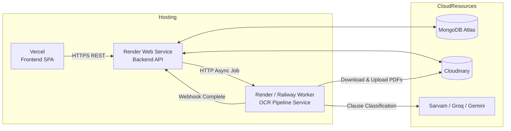

# BimaLens — Setup, Cloud Infrastructure & Operations Manual (docs.md)

This comprehensive manual provides complete, step-by-step instructions for configuring all required API keys, setting up cloud databases and storage, deploying the application across cloud platforms (Render and Vercel), and operating the multi-service architecture.

---

## 📑 Table of Contents
1. [Cloud Services & API Keys Setup](#1-cloud-services--api-keys-setup)
   - [1.1 MongoDB Atlas Database](#11-mongodb-atlas-database)
   - [1.2 Cloudinary Storage](#12-cloudinary-storage)
   - [1.3 Sarvam AI API (Primary GenAI)](#13-sarvam-ai-api-primary-genai)
   - [1.4 Groq Cloud API (Secondary Inference)](#14-groq-cloud-api-secondary-inference)
   - [1.5 Google Gemini API (Tertiary Fallback)](#15-google-gemini-api-tertiary-fallback)
2. [Environment Configuration Reference](#2-environment-configuration-reference)
3. [Production Deployment Guide](#3-production-deployment-guide)
   - [3.1 Deploying Backend on Render](#31-deploying-backend-on-render)
   - [3.2 Deploying OCR Pipeline on Render / Railway](#32-deploying-ocr-pipeline-on-render--railway)
   - [3.3 Deploying Frontend on Vercel](#33-deploying-frontend-on-vercel)
4. [API & Webhook Specifications](#4-api--webhook-specifications)
5. [OCR & PDF Annotation Coordinate Engine](#5-ocr--pdf-annotation-coordinate-engine)
6. [CI/CD & GitHub Actions Workflow](#6-cicd--github-actions-workflow)
7. [Troubleshooting & Frequently Asked Questions](#7-troubleshooting--frequently-asked-questions)

---

## 1. Cloud Services & API Keys Setup

### 1.1 MongoDB Atlas Database

BimaLens uses MongoDB Atlas as its primary document store for policy metadata, processing states, extracted clause analyses, and chat histories.

#### Step-by-Step Setup:
1. Visit [MongoDB Atlas](https://www.mongodb.com/cloud/atlas) and create a free account or sign in.
2. Click **"Build a Database"** and select the free **M0 Shared Cluster**.
3. Choose your preferred cloud provider (AWS / GCP / Azure) and a region near your users (e.g., `ap-south-1` Mumbai).
4. **Create a Database User**:
   - Go to **Security > Database Access > Add New Database User**.
   - Authentication Method: **Password**.
   - Username: `bimalens_admin`.
   - Set a strong password (e.g., `SecureBimaPass2026!`). Note this down.
   - Database User Privileges: `Read and write to any database`.
5. **Configure Network Access (IP Whitelist)**:
   - Go to **Security > Network Access > Add IP Address**.
   - For local development and serverless platforms like Render/Vercel, select **"Allow Access from Anywhere"** (`0.0.0.0/0`).
   - Click **Confirm**.
6. **Obtain Connection String URI**:
   - Return to **Deployments > Database**.
   - Click **Connect > Drivers > Python (version 3.12 or later)**.
   - Copy the SRV connection string:
     ```
     mongodb+srv://bimalens_admin:<password>@cluster0.xxxxx.mongodb.net/bimalens?retryWrites=true&w=majority
     ```
   - Replace `<password>` with your actual password, and ensure the database name at the end is `bimalens`.

---

### 1.2 Cloudinary Storage

Cloudinary stores original uploaded policy PDFs and the newly generated color-coded annotated PDFs.

#### Step-by-Step Setup:
1. Sign up for a free account at [Cloudinary](https://cloudinary.com/).
2. Once logged in, navigate to your **Dashboard**.
3. Under **Product Environment Credentials**, copy the three values:
   - **Cloud Name** (e.g., `dxa8xxxx`)
   - **API Key** (e.g., `483928193847291`)
   - **API Secret** (e.g., `aBcDeFgHiJkLmNoPqRsTuVwXyZ`)
4. **Configure PDF Asset Delivery**:
   - In Cloudinary Console, navigate to **Settings > Security**.
   - Ensure that **"PDF and ZIP files delivery"** is enabled so that raw PDF uploads can be served directly to the frontend viewer.

---

### 1.3 Sarvam AI API (Primary GenAI)

Sarvam AI is the primary model (`sarvam-m`) powering high-precision clause classification and Indian insurance policy reasoning.

#### Step-by-Step Setup:
1. Register at the [Sarvam AI Developer Portal](https://dashboard.sarvam.ai/).
2. Navigate to **API Keys** and generate a new key.
3. Note your API Key (e.g., `sk_sarvam_...`).
4. Sarvam provides an OpenAI-compatible API endpoint:
   - **Base URL:** `https://api.sarvam.ai/v1`
   - **Default Model:** `sarvam-m`

---

### 1.4 Groq Cloud API (Secondary Inference)

Groq delivers ultra-fast secondary inference using open-weights models (`qwen-qwq-32b` or `qwen-2.5-32b`), ensuring prompt failover if the primary provider is unreachable.

#### Step-by-Step Setup:
1. Sign up at [Groq Console](https://console.groq.com/).
2. Navigate to **API Keys** and click **"Create API Key"**.
3. Name your key (e.g., `bimalens-groq-key`) and copy the generated key string (`gsk_...`).
4. In your environment, configure:
   - **API Key:** `gsk_...`
   - **Model:** `qwen-qwq-32b`

---

### 1.5 Google Gemini API (Tertiary Fallback)

Google Gemini (`gemini-2.0-flash` or `gemini-1.5-flash`) acts as the robust third-tier fallback in the LangChain chain.

#### Step-by-Step Setup:
1. Visit [Google AI Studio](https://aistudio.google.com/).
2. Click **"Get API key"** and select **"Create API key in new project"**.
3. Copy the generated key (`AIzaSy...`).
4. In your environment, set `GOOGLE_API_KEY=AIzaSy...`.

---

## 2. Environment Configuration Reference

### Backend Service (`backend/.env`)

| Variable Name | Required | Default Value | Description |
| :--- | :---: | :--- | :--- |
| `MONGODB_URI` | **Yes** | — | MongoDB Atlas SRV connection string with credentials. |
| `CLOUDINARY_CLOUD_NAME` | **Yes** | — | Cloudinary cloud identifier. |
| `CLOUDINARY_API_KEY` | **Yes** | — | Cloudinary API Key. |
| `CLOUDINARY_API_SECRET` | **Yes** | — | Cloudinary API Secret. |
| `SARVAM_API_KEY` | Optional* | — | API key for Sarvam AI. |
| `SARVAM_API_BASE` | No | `https://api.sarvam.ai/v1` | Sarvam OpenAI-compatible base URL. |
| `GROQ_API_KEY` | Optional* | — | API key for Groq inference. |
| `GOOGLE_API_KEY` | Optional* | — | API key for Google Gemini. |
| `OCR_PIPELINE_URL` | **Yes** | `http://localhost:8001` | URL where the OCR service is reachable. |
| `BACKEND_CALLBACK_URL` | **Yes** | `http://localhost:8000` | Publicly reachable backend URL for webhooks. |
| `CORS_ORIGINS` | No | `http://localhost:5173,http://localhost:3000` | Comma-delimited permitted CORS origins. |

*\*At least one LLM key must be configured for AI classification and chat functionality.*

---

### OCR Pipeline Service (`ocr-pipeline/.env`)

| Variable Name | Required | Default Value | Description |
| :--- | :---: | :--- | :--- |
| `SARVAM_API_KEY` | Optional* | — | Sarvam AI API key. |
| `SARVAM_API_BASE` | No | `https://api.sarvam.ai/v1` | Sarvam base URL. |
| `GROQ_API_KEY` | Optional* | — | Groq API key. |
| `GOOGLE_API_KEY` | Optional* | — | Google Gemini API key. |
| `CLOUDINARY_CLOUD_NAME` | **Yes** | — | Cloudinary cloud identifier for saving annotated PDFs. |
| `CLOUDINARY_API_KEY` | **Yes** | — | Cloudinary API Key. |
| `CLOUDINARY_API_SECRET` | **Yes** | — | Cloudinary API Secret. |
| `BACKEND_CALLBACK_URL` | **Yes** | `http://localhost:8000` | Backend URL to receive the `/api/v1/webhooks/ocr-complete` callback. |
| `PAGE_CLASSIFICATION_DELAY` | No | `3.0` | Throttling pause (seconds) between pages to respect rate limits. |
| `PORT` | No | `8001` | Port on which the service listens. |

---

### Frontend Web App (`frontend/.env`)

| Variable Name | Required | Default Value | Description |
| :--- | :---: | :--- | :--- |
| `VITE_API_BASE_URL` | **Yes** | `http://localhost:8000` | Base URL of the deployed or local Backend API service. |

---

## 3. Production Deployment Guide



### 3.1 Deploying Backend on Render

1. Log in to [Render](https://render.com/).
2. Click **New + > Web Service**.
3. Connect your GitHub repository containing BimaLens.
4. Configure the Web Service settings:
   - **Name:** `bimalens-backend`
   - **Root Directory:** `backend`
   - **Runtime:** `Python` (or `Docker` using `backend/Dockerfile`)
   - **Build Command:** `pip install -r requirements.txt`
   - **Start Command:** `uvicorn app.main:app --host 0.0.0.0 --port $PORT`
   - **Instance Type:** Starter (or Free tier)
5. Add the Environment Variables from the **Backend Service Table** above:
   - Set `BACKEND_CALLBACK_URL` to your Render service URL (e.g., `https://bimalens-backend.onrender.com`).
   - Set `OCR_PIPELINE_URL` to your OCR pipeline service URL (e.g., `https://bimalens-ocr.onrender.com`).
   - Set `CORS_ORIGINS` to include your Vercel domain (e.g., `https://bimalens.vercel.app`).
6. Set the Health Check Path to `/health`.
7. Click **Create Web Service**.

---

### 3.2 Deploying OCR Pipeline on Render / Railway

Because the OCR Pipeline utilizes `obliq-ocr` (ONNX Runtime, OpenCV, PyMuPDF), deploying via the included `ocr-pipeline/Dockerfile` is strongly recommended to guarantee system graphics libraries (`libGL`, `libglib`) are pre-installed.

1. On Render, click **New + > Web Service**.
2. Connect the repository and select:
   - **Root Directory:** `ocr-pipeline`
   - **Environment:** `Docker`
   - **Instance Type:** Starter (minimum 1GB RAM recommended for OCR operations)
3. Add the required Environment Variables from the **OCR Pipeline Table**:
   - `BACKEND_CALLBACK_URL`: `https://bimalens-backend.onrender.com`
   - Cloudinary keys and LLM keys.
4. Set Health Check path to `/health`.
5. Deploy the service. Copy its public URL (e.g., `https://bimalens-ocr.onrender.com`) and paste it into the backend's `OCR_PIPELINE_URL` environment variable.

---

### 3.3 Deploying Frontend on Vercel

1. Log in to [Vercel](https://vercel.com/).
2. Click **"Add New Project"** and select your BimaLens repository.
3. Configure Project Settings:
   - **Framework Preset:** `Vite`
   - **Root Directory:** click Edit and select `frontend`
   - **Build Command:** `npm run build`
   - **Output Directory:** `dist`
4. **Environment Variables**:
   - Add `VITE_API_BASE_URL` with your Render backend URL:
     ```
     VITE_API_BASE_URL=https://bimalens-backend.onrender.com
     ```
5. **SPA Routing Support (`vercel.json`)**:
   Ensure `frontend/vercel.json` exists with the following configuration to handle client-side routing:
   ```json
   {
     "rewrites": [
       { "source": "/(.*)", "destination": "/index.html" }
     ]
   }
   ```
6. Click **Deploy**. Vercel will build and assign your production URL (e.g., `https://bimalens.vercel.app`).

---

## 4. API & Webhook Specifications

### 4.1 Backend Endpoints

#### `POST /api/v1/policies/upload`
Uploads a policy document (`multipart/form-data`) to Cloudinary and dispatches the OCR processing job.
- **Request:**
  ```http
  POST /api/v1/policies/upload HTTP/1.1
  Content-Type: multipart/form-data

  file: [sample_policy.pdf]
  ```
- **Response (200 OK):**
  ```json
  {
    "policy_id": "6735a1f2e4b029a1b8c0d123",
    "status": "processing"
  }
  ```

---

#### `GET /api/v1/policies`
Returns a list of all uploaded policy documents sorted by upload date descending.
- **Response (200 OK):**
  ```json
  [
    {
      "_id": "6735a1f2e4b029a1b8c0d123",
      "filename": "sample_policy.pdf",
      "cloudinary_url": "https://res.cloudinary.com/.../sample_policy.pdf",
      "uploaded_at": "2026-11-14T08:00:00Z",
      "status": "ready",
      "annotated_pdf_url": "https://res.cloudinary.com/.../sample_policy_annotated.pdf"
    }
  ]
  ```

---

#### `GET /api/v1/policies/{policy_id}/status`
Polls the processing status of a policy document.
- **Response (200 OK):**
  ```json
  {
    "policy_id": "6735a1f2e4b029a1b8c0d123",
    "status": "ready",
    "filename": "sample_policy.pdf"
  }
  ```
- *Possible Status Values:* `processing`, `ready`, `failed`, `ocr_trigger_failed`.

---

#### `POST /api/v1/policies/{policy_id}/ask`
Queries the policy with strict factual grounding against extracted clauses.
- **Request:**
  ```json
  {
    "question": "What is the duration of the free look period if I purchased online?",
    "language": "en"
  }
  ```
- **Response (200 OK):**
  ```json
  {
    "answer": "According to Part A of your policy, the free-look period is 30 days if the policy was purchased online (15 days for offline purchases). You may return the policy within this timeframe stating the reasons of your objections.",
    "sources": [
      {
        "page": 1,
        "section": "PART - A",
        "quote": "you may return the Policy within a period of 15 days (30 days if this policy is purchased online)"
      }
    ]
  }
  ```

---

### 4.2 OCR Pipeline Webhook (`POST /api/v1/webhooks/ocr-complete`)

Dispatched by the OCR Pipeline to the Backend when analysis and annotation are finalized:

```json
{
  "policy_id": "6735a1f2e4b029a1b8c0d123",
  "status": "completed",
  "annotated_pdf_url": "https://res.cloudinary.com/demo/raw/upload/v1/bimalens/annotated/sample_policy_annotated.pdf",
  "analysis_data": {
    "total_pages": 21,
    "classifications": [
      {
        "page_number": 1,
        "section_title": "PART - A",
        "extracted_points": [
          {
            "category": "Obligation",
            "point_summary": "Free Look cancellation allowed within 15 days, or 30 days if purchased online.",
            "exact_quote": "you may return the Policy within a period of 15 days (30 days if this policy is purchased online)",
            "continuity_flag": false
          },
          {
            "category": "Financial",
            "point_summary": "Refund on free look cancellation is subject to deductions for stamp duty and any annuity paid.",
            "exact_quote": "premium deposited by you shall be refunded to you after deducting the charges for stamp duty and Annuity paid (if any)",
            "continuity_flag": false
          }
        ]
      }
    ]
  }
}
```

---

## 5. OCR & PDF Annotation Coordinate Engine

The annotation engine synchronizes the coordinate systems of `obliq-ocr` and `PyMuPDF (fitz)`:

```
+-------------------------------------------------------------+
|                      OCR Pipeline Flow                      |
|                                                             |
|  1. PDF Page Rendered / Scanned                             |
|     Image Resolution: 200 DPI (Pixels: X_px, Y_px)          |
|                                                             |
|  2. LLM Extraction                                          |
|     Returns: verbatim quote string                          |
|                                                             |
|  3. Resolution Conversion (Scale Factor)                    |
|     scale = 72.0 / 200.0 = 0.36                             |
|     Points: X_pt = X_px * scale, Y_pt = Y_px * scale        |
|                                                             |
|  4. Coordinate Matching:                                    |
|     ├── Try Native PDF Text Search: page.search_for(quote)  |
|     └── If empty: Fallback to RapidFuzz partial_ratio >= 80 |
|         against OCR token bounding boxes                    |
|                                                             |
|  5. Draw Annotation in PyMuPDF:                             |
|     annot = page.add_rect_annot(fitz.Rect(x0, y0, x1, y1))  |
|     annot.set_colors(stroke=color, fill=color)              |
|     annot.set_opacity(0.25)                                 |
|     annot.set_info(title=category, content=summary)         |
+-------------------------------------------------------------+
```

---

## 6. CI/CD & GitHub Actions Workflow

The repository includes an automated continuous integration pipeline in `.github/workflows/pr-check.yml` that validates pull requests:

```yaml
name: BimaLens PR Verification

on:
  pull_request:
    branches: [main, master]
  push:
    branches: [main, master]

jobs:
  backend-lint-and-test:
    runs-on: ubuntu-latest
    steps:
      - uses: actions/checkout@v4
      - name: Set up Python
        uses: actions/setup-python@v5
        with:
          python-version: "3.12"
      - name: Install dependencies
        run: |
          python -m pip install --upgrade pip
          pip install flake8
          pip install -r backend/requirements.txt
      - name: Lint Backend
        run: flake8 backend --count --select=E9,F63,F7,F82 --show-source --statistics

  frontend-build:
    runs-on: ubuntu-latest
    steps:
      - uses: actions/checkout@v4
      - name: Set up Node.js
        uses: actions/setup-node@v4
        with:
          node-version: "20"
      - name: Install and Build Frontend
        working-directory: ./frontend
        run: |
          npm ci
          npm run build
```

---

## 7. Troubleshooting & Frequently Asked Questions

### Q1: What happens if Sarvam AI runs out of quota or returns a rate limit error?
**A:** BimaLens implements an automated **LangChain Fallback Strategy**. If Sarvam AI returns a 429 (Resource Exhausted) or 5xx error, the request is transparently re-routed to Groq (`qwen-qwq-32b`). If Groq encounters an issue, it falls back to Google Gemini (`gemini-2.0-flash`).

### Q2: Why are bounding boxes offset or misaligned on certain scanned documents?
**A:** Scanned PDFs are analyzed at a target rendering DPI (default: 200 DPI). The PyMuPDF points coordinate system operates at 72 points per inch. Ensure `dpi: int = 200` matches the OCR canvas rendering resolution so that the scale factor `scale = 72.0 / dpi` maps accurately.

### Q3: MongoDB Atlas raises `ServerSelectionTimeoutError` or DNS resolution failures.
**A:** 
1. Ensure your current public IP address is whitelisted under **Network Access** in MongoDB Atlas (or set to `0.0.0.0/0`).
2. Verify that your environment uses `dnspython` (included in `motor` dependencies) for SRV records.

### Q4: Cloudinary returns HTTP 401 or Invalid Signature.
**A:** Check that you are uploading PDFs with `resource_type="raw"` rather than `image`. In addition, ensure your `CLOUDINARY_API_KEY` and `CLOUDINARY_API_SECRET` do not have trailing whitespaces.
